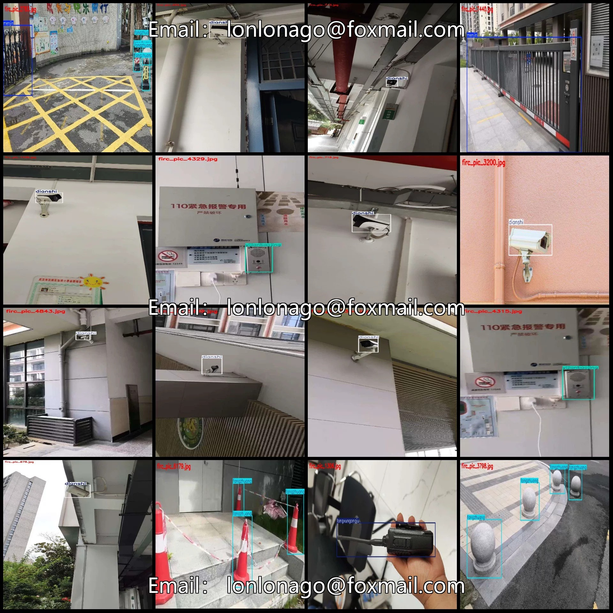
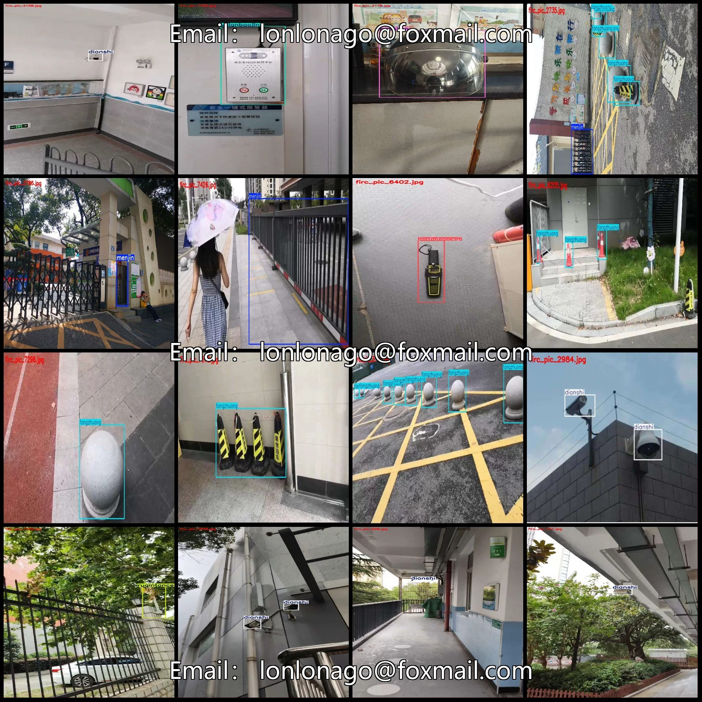
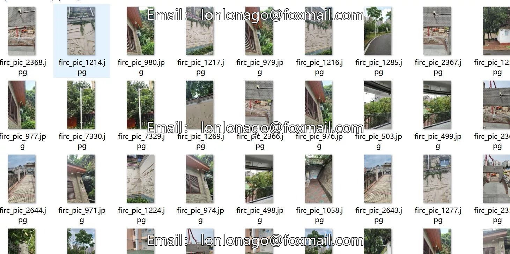
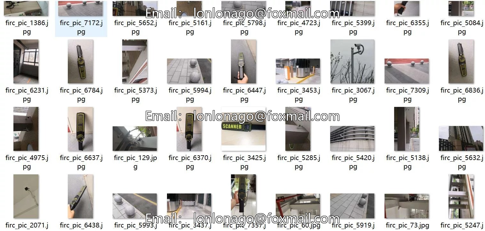

# Intelligent Campus Security Equipment Inspection Data Set - VOC+YOLO Format: 7896 Images, 12

## Body

Smart Campus Security Equipment Inspection Data Set - VOC+YOLO Format: 7896 Images in 12 Categories
Warm Reminder: Due to the dataset's replicability, please confirm compliance with requirements before purchasing.
Dataset Format: Pascal VOC format + YOLO format (txt files without split paths, only containing jpg images and corresponding VOC format xml files and yolo format txt files)
Number of Images (Total jpg files): 7896
Number of Annotations (Total xml files): 7896
Number of Annotations (Total txt files): 7896
Number of Annotation Categories: 12

Label category names (Note that the order of categories in the YOLO format does not correspond to this, but is based on the labels folder's classes.txt): ["badajian", "chuanghu", "dianshi", "fanghumen", "fangzhuang", "jinshutanceqi", "menjin", "ruqintance", "shitifanghu", "tongxungongju", "yijianbaojing", "yingjimen"]

8 major items, window, TV, protective door, collision prevention, metal detector, access control, intrusion detection, physical protection, communication tools, one-button alarm, emergency door.
Number of frames per category:
badajian = 299
chuanghu = 9
dianshi = 5279
fanghumen = 36
fangzhuang = 4620
jinshutanceqi = 784
menjin = 675

Frame count = 423
shitifanghu box count = 1
tongxungongju Frame Count = 98
yijianbaojing frame count = 257
Yingjimen Frames = 41
Total frame count: 12522
Number of images per category
Badajian's possession of images = 228
chuanghu occupancy = 8
Dianshi's possession of images = 4135
Fanghumen occupies a total of 35 images.
Fangzhuang occupies the number of images = 1563

Jinshutanceqi occupies 768 images
Menjin occupies 665 images
Ruqintance occupies 234 images
Shitifanghu occupies 1 image
Tongxungongju occupies 98 images
Yijianbaojing occupies 254 images
Yingjimen occupies 41 images
Image resolution: Multi-resolution images, such as 1024x1820, 1024x576, etc.
Labeling tool used: labelImg
Labeling rules: Draw a rectangle around the category.

Important Notice: The dataset does not have separate training, validation, and test sets; you need to partition them yourself.
Special : This dataset does not guarantee the accuracy of the trained models or weight files.

## Images

## Payment

Here is a pay link on Stripe ( https://buy.stripe.com/3cs8yP7sY87d0vu9AB ). Please contact me lonlonago@foxmail.com after funding $89, and I will send you a complete data files , thank you!

